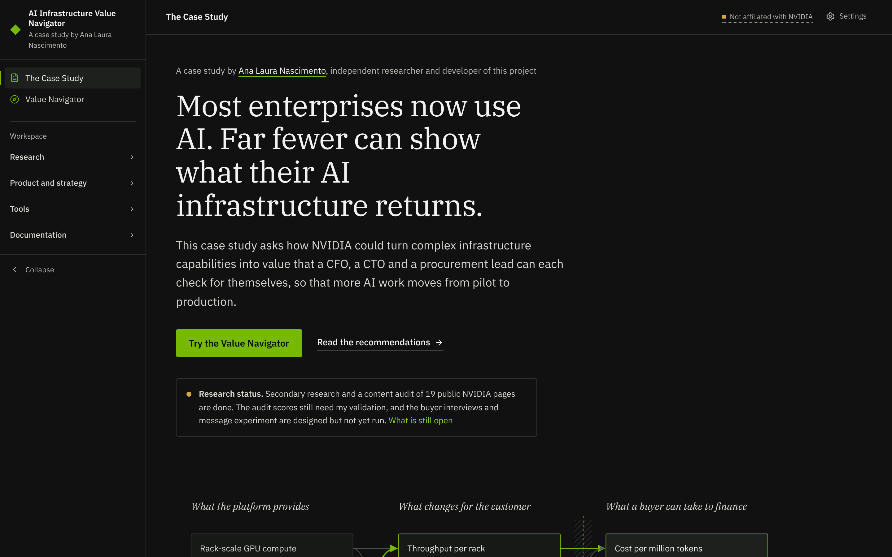
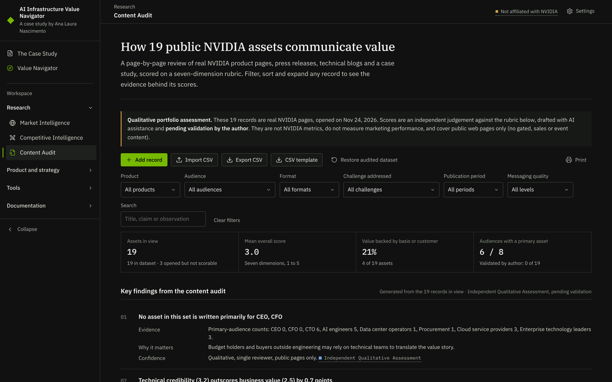
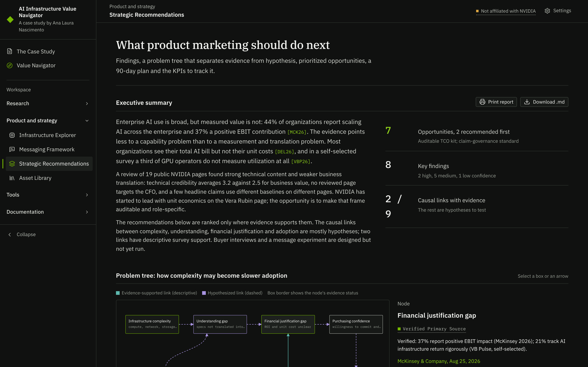

# AI Infrastructure Value Navigator

**The Enterprise AI Infrastructure Adoption Gap: an independent product marketing case study.**

A working application that asks where enterprise AI infrastructure adoption stalls, how well NVIDIA's public content addresses those points, and which product marketing actions the evidence supports.

**[Open the live app](https://analaura-n-s.github.io/ai-infrastructure-value-navigator/)**

> **Independence.** This is an independent educational portfolio project. It is not affiliated with, sponsored by or endorsed by NVIDIA Corporation, and NVIDIA has not reviewed it. NVIDIA, Blackwell, Vera Rubin, NVLink and other marks belong to their owners. Simulated financial results are not NVIDIA pricing or performance data. Concept assets are the author's own work, not NVIDIA material.



## Research question

*How can NVIDIA translate complex AI infrastructure capabilities into clear, measurable, audience-specific value propositions that support enterprise adoption?*

Sub-questions:

1. What blocks enterprises from moving AI infrastructure from pilots to scaled production?
2. How well does NVIDIA's public content address those blocks, and for which audiences?
3. Which product marketing actions are supported by evidence, and which are still hypotheses?

## Methodology

**Evidence labels.** Every statement in the app carries one of six evidence statuses: Verified Primary Source, Verified Secondary Source, Independent Qualitative Assessment, Strategic Hypothesis, Illustrative Assumption or Pending Validation. Content is also labeled by type: verified industry challenge, NVIDIA-specific observation, strategic hypothesis, research finding or recommendation.

**Secondary research.** 48 sources were read on the publisher's page on Nov 24, 2026, and stored with publisher, date, sample, method and a stated limitation. Ten sources have details that could not be confirmed and are flagged in the app. Self-selected and vendor-sponsored samples are labeled. Figures from different surveys are never combined or ranked.

**Content audit.** 19 public NVIDIA pages (product pages, solution pages, press releases, technical blogs, a program page and a case study) were opened and recorded field by field with verbatim excerpts. Each was scored 1 to 5 on seven anchored dimensions: clarity, audience relevance, business value, technical credibility, evidence, competitive differentiation and call to action. Scores were drafted with AI assistance by one reviewer and are **pending the author's validation**. Three pages that could not be read were excluded rather than guessed.

**Strategy.** Findings state their evidence, confidence and limitation. In the causal problem tree, only two of nine links are marked evidence-supported (descriptive survey associations); the rest are hypotheses. Opportunity scores are the author's proposed judgements and can be edited in the app.

**Messaging experiment.** A between-subjects design (feature-focused versus benefit-focused message), seven 7-point measures, Welch t-tests with Holm correction, 95% confidence intervals and Cohen's d. **The study has not been run. No results are shown or simulated.** The dashboard stays empty until real responses are imported.

**Financial simulation.** All simulator defaults are illustrative assumptions.

```
IT power (kW)                 = GPUs × W ÷ 1,000
Annual energy (kWh)           = kW × operating hours × PUE
Annual OPEX                   = electricity + maintenance + software
CAPEX                         = acquisition + implementation
TCO (nominal)                 = CAPEX + OPEX × lifespan
NPV                           = −CAPEX + Σ (benefits − OPEX) ÷ (1 + r)^t
ROI                           = (benefits × lifespan − TCO) ÷ TCO
Cost per productive GPU-hour  = (CAPEX ÷ lifespan + OPEX) ÷ (GPUs × hours × utilization)
```

**AI use.** Generative AI (Claude) assisted with code, page summaries, score drafts and message drafts. The AI Workflow section logs this and shows a claim-by-claim verification table. The in-app engines (Value Navigator, Messaging Studio, workflow demonstration) are rule-based and say so. **No AI model or API is called by the app.**

## What's inside

The app has two layers. **The Case Study** is an editorial overview a reader can take in within a minute, with the **Value Navigator** as its central interactive piece. The **workspace** below it holds the full research and tools in four groups, each collapsed until you open it.

| Group | Section | What it does |
|---|---|---|
| Case study | The Case Study | The problem, the evidence and the approach, an illustrated capability-to-value framework, the author and the research status |
| | Value Navigator | Customer value brief by role, industry, workload, challenge and maturity |
| Research | Market Intelligence | Evidence register across nine adoption-gap dimensions, with filters by dimension, content type and evidence status |
| | Competitive Intelligence | Vendor documentation for NVIDIA, AMD Instinct, Google Cloud TPU and AWS Trainium/Inferentia, with expandable sources and analyst notes |
| | Content Audit | 19 real NVIDIA assets: dashboard, dynamic findings, seven charts, heatmap, coverage matrix, sortable and editable records, CSV import and export |
| Product & Strategy | Infrastructure Explorer | Full-stack architecture map with technical and business explanations |
| | Messaging Framework | Eight audiences with profile, value proposition, objectives, pain points, objections, proof points and CTA, plus a feature-to-benefit matrix |
| | Strategic Recommendations | Executive summary, causal problem tree, findings, opportunities, Impact vs Effort matrix, 90-day roadmap and KPI framework |
| | Asset Library | Six concept documents (executive one-pager, CFO briefing, technical overview, sales battlecard, landing page, webinar campaign) |
| Tools | TCO & ROI Simulator | Two-scenario financial model with sensitivity analysis and CSV export |
| | Messaging Studio | Rule-based message builder with a claim-check panel |
| | Messaging Experiment Lab | Study protocol, power calculator, CSV import and a Welch/Holm analysis dashboard |
| Documentation | AI Workflow | Eight-step human-in-the-loop workflow, rule-based demonstration, case study, claim verification table and AI activity log |
| | Methodology & Sources | Methods, limitations, searchable source library and the list of research still pending |
| | About the Project | Author, objective, competencies and independence statement |

| Content Audit | Strategic Recommendations |
|---|---|
|  |  |

## Deliverables

The files in [`docs/deliverables/`](docs/deliverables/) are exported from the app by `tests/export-deliverables.js`, so they match what the app shows.

| Deliverable | File |
|---|---|
| Source library | [source-library.csv](docs/deliverables/source-library.csv) |
| Content audit dataset | [content-audit.csv](docs/deliverables/content-audit.csv) |
| Strategic recommendations | [strategic-recommendations.md](docs/deliverables/strategic-recommendations.md) |
| Messaging framework | [messaging-framework.md](docs/deliverables/messaging-framework.md) |
| Asset library (6 concepts) | [asset-library/](docs/deliverables/asset-library/) |
| Experiment protocol and response template | [experiment-protocol.md](docs/deliverables/experiment-protocol.md), [experiment-response-template.csv](docs/deliverables/experiment-response-template.csv) |
| AI workflow claim table and activity log | [ai-workflow-claim-verification.md](docs/deliverables/ai-workflow-claim-verification.md), [ai-activity-log.csv](docs/deliverables/ai-activity-log.csv) |
| KPI framework | [kpi-framework.csv](docs/deliverables/kpi-framework.csv) |

## Limitations

- Public web pages only. Gated, sales-enablement and event content was not reviewed and may already address some gaps.
- The content audit has a single reviewer, and its scores are pending the author's validation. No inter-rater check has been done yet.
- No primary research yet: no buyer interviews, and the message experiment has not been run.
- Several survey samples are self-selected or vendor-sponsored, and their definitions of "scaling" and "impact" differ.
- The IEA *Energy and AI* report and NVIDIA's Form 10-K (Item 1 and Item 1A) have not been read yet.
- Pages change. Everything reflects the pages as read on Nov 24, 2026.

## Implementation

- Static HTML, CSS and JavaScript. No backend, build step, API keys or tracking.
- `index.html` holds the shell and static sections. Scripts load in order: `assets/js/vendor/chart.umd.min.js`, `data.js` (Phase 1 data), `research.js` (sources, evidence, audit, strategy, framework, assets, experiment, workflow), `core.js` (helpers, CSV, charts, statistics), `sections-a.js`, `sections-b.js`, `main.js` (navigation and boot).
- Plain scripts rather than ES modules, so the app also runs when opened directly from disk.
- Chart.js 4.4.7 (MIT) is bundled locally. Icons are an inline Lucide sprite (ISC). Fonts are IBM Plex from Google Fonts, with system fallbacks.
- Inputs, edits, notes and logs are saved only in the browser's `localStorage` (prefix `aivn.`) and can be cleared from **Settings → Delete saved data** (with a confirmation step).
- CSV export guards against spreadsheet formula injection. Imports validate every row and report skipped rows.
- Keyboard-navigable with visible focus, labeled controls, a modal focus trap, responsive layouts down to 360 px, and print layouts for the brief, the financial report, the strategy and each concept document.

### Run locally

Clone the repository and open `index.html` in a modern browser. No server is needed.

### Tests

```
npm install playwright
node tests/regression.js          # 56 checks: every view, calculations, statistics, CSV, audit editing, experiment import, workflow approval, navigation, settings, mobile, print
node tests/export-deliverables.js # regenerates docs/deliverables/ from the app
```

The experiment rows used in `tests/regression.js` exist only inside the test to check the statistics. They are not shipped and are not research data.

## Publishing on GitHub Pages

1. Merge the pull request into `main`.
2. In the repository, open **Settings → Pages**.
3. Under **Build and deployment**, set **Source** to *Deploy from a branch*, **Branch** to `main` and the folder to `/ (root)`, then save. (This is already set for this repository.)
4. Wait one to two minutes, then open https://analaura-n-s.github.io/ai-infrastructure-value-navigator/. If the old version still shows, hard-refresh the page.
5. The empty `.nojekyll` file at the root tells Pages to serve the files as they are.

## Research still pending

See the **Research still pending** list in the Methodology section of the app. In short: validate the audit scores, add a second reviewer, run buyer interviews and the message experiment, read the IEA report and NVIDIA's 10-K, and confirm three flagged figures.

---

Independent Technical Product Marketing & Business Analytics Case Study | Created by Ana Laura Nascimento | 2026
