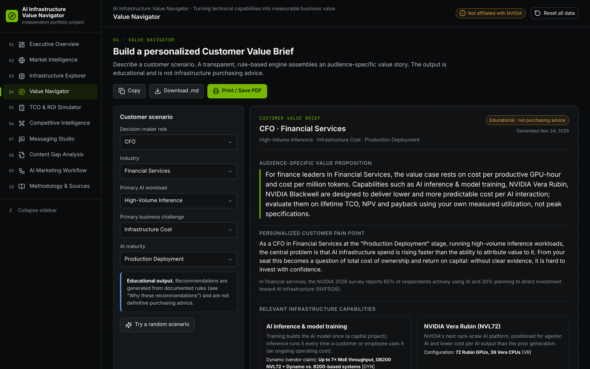
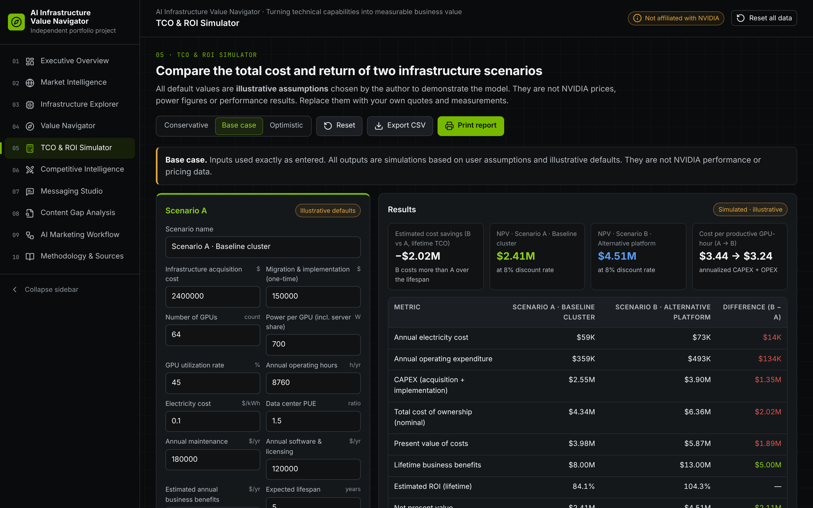

# AI Infrastructure Value Navigator

**Turning technical capabilities into measurable business value.**

An interactive decision-support app that explores how complex AI infrastructure capabilities can be translated into clear, audience-specific business value for enterprise buyers.

**[Open the live app →](https://analaura-n-s.github.io/ai-infrastructure-value-navigator/)**

> **Disclaimer:** This is an independent educational portfolio project. It is not affiliated with, sponsored by or endorsed by NVIDIA Corporation. NVIDIA, Blackwell, Vera Rubin, NVLink and other marks belong to their respective owners. Simulated financial results are not NVIDIA pricing or performance data.


## Research question

*How can NVIDIA translate complex AI infrastructure capabilities into clear, measurable, and audience-specific business value propositions to support enterprise adoption?*

Enterprise decision-makers often struggle to understand technical capabilities, evaluate total cost of ownership, estimate returns and choose the right infrastructure. This project bridges technical product documentation and commercial decision-making.

## What's inside

| # | Section | What it does |
|---|---------|--------------|
| 1 | Executive Overview | KPI cards and charts built from published research on AI adoption, scaling, ROI and infrastructure barriers |
| 2 | Market Intelligence | Filterable barrier evidence, segmentation, buyer differences, trends and "What This Means for NVIDIA" |
| 3 | Infrastructure Explorer | Interactive full-stack architecture map with technical and business explanations |
| 4 | Value Navigator | Builds a personalized Customer Value Brief by role, industry, workload, challenge and AI maturity, which you can print or export |
| 5 | TCO & ROI Simulator | Two-scenario model with TCO, NPV, ROI, payback, cost per productive GPU-hour, sensitivity analysis and CSV export |
| 6 | Competitive Intelligence | Filterable comparison of NVIDIA, AMD Instinct, Google Cloud TPU and AWS Trainium/Inferentia, built from vendor documentation |
| 7 | Messaging Studio | Rule-based structured messaging generator with a feature-versus-benefit comparison |
| 8 | Content Gap Analysis | Editable content audit with a scoring rubric, coverage heatmap, prioritized backlog, and CSV import and export |
| 9 | AI Marketing Workflow | Human-in-the-loop workflow demonstration plus a reusable prompt library |
| 10 | Methodology & Sources | Methods, formulas, limitations and a searchable source library |

| Value Navigator | TCO & ROI Simulator |
|---|---|
|  |  |

## Methodology

- **Secondary research.** Every statistic, specification and URL was checked against the live source page on Nov 24, 2026, and is shown with its publisher, publication date and sample size where disclosed.
- **Sources.** McKinsey *The State of AI* (2025 and 2026), Deloitte *State of Generative AI in the Enterprise* (Q4) and *State of AI in the Enterprise* (2026), NVIDIA *State of AI in Financial Services* (2025 and 2026), NVIDIA fiscal 2026 results, Uptime Institute (2025), and official NVIDIA, AMD, Google Cloud and AWS documentation. The full list with links is in the app's **Methodology & Sources** section.
- **Evidence labeling.** Verified findings are kept separate from the author's strategic hypotheses. Details that could not be confirmed are flagged in the app: the exact Uptime average PUE, the current EIA electricity price and the Deloitte 2026 publication date. Vendor "up to" claims are labeled as projections and given with their stated baselines.
- **Illustrative data.** The simulator's default values and the content audit dataset are clearly labeled as illustrative or demonstration data. The demo audit uses example.com URLs and does not assess NVIDIA's real content.
- **Transparent engines.** The Value Navigator, Messaging Studio and Workflow use documented, rule-based logic. No live AI model or API is called.

### TCO & ROI formulas

```
Annual energy (kWh)          = GPUs × W per GPU ÷ 1,000 × operating hours × PUE
Annual OPEX                  = electricity + maintenance + software & licensing
CAPEX                        = acquisition + migration & implementation
TCO (nominal)                = CAPEX + OPEX × lifespan
NPV                          = −CAPEX + Σ (benefits − OPEX) ÷ (1 + r)^t
ROI                          = (benefits × lifespan − TCO) ÷ TCO
Cost per productive GPU-hour = (CAPEX ÷ lifespan + OPEX) ÷ (GPUs × hours × utilization)
```

## Technical notes

- A single self-contained HTML file (`index.html`) with no backend, build step or credentials.
- Chart.js v4.4.7 (MIT) and Lucide icons v0.460.0 (ISC) are embedded, so the app also works offline.
- User inputs and edited datasets are saved in the browser's `localStorage`, and the app includes reset controls.
- Responsive and keyboard-navigable, with print layouts for the Customer Value Brief and the financial report.

To run it locally, download `index.html` and open it in any modern browser.

## Skills demonstrated

Technical product marketing · Market research · Business analytics · Customer segmentation · Competitive intelligence · Messaging and positioning · Financial modeling · Data visualization · Generative AI workflows · Strategic communication

---

Independent Product Marketing & Business Analytics Portfolio Project | Created by Ana Laura Nascimento Silva | 2026
